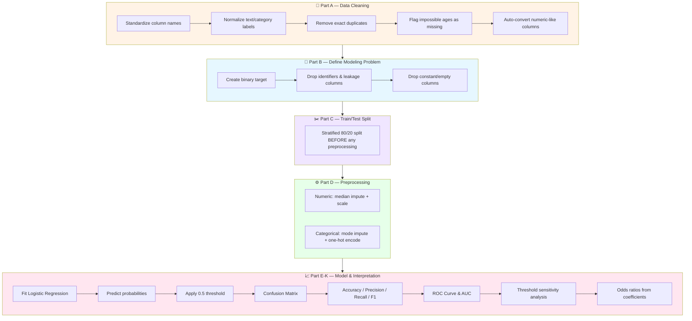
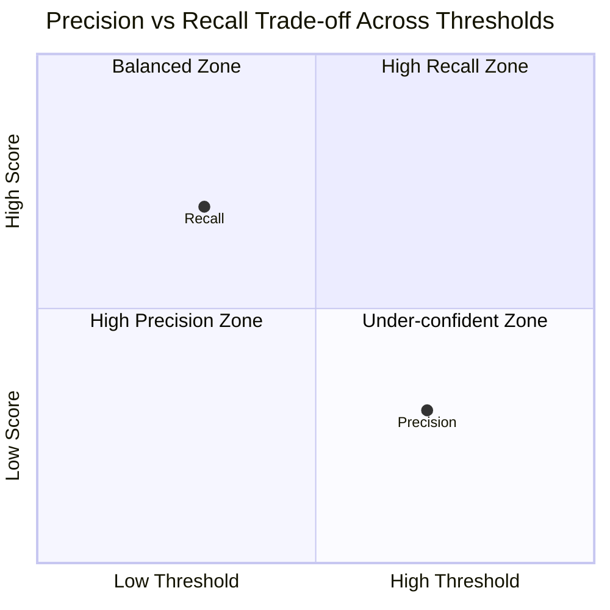

<div align="center">

# 🎗️ Breast Cancer Classification with Logistic Regression

### A leakage-aware, end-to-end ML pipeline for diagnosing malignant vs. benign tumors

[](https://www.python.org/)
[](https://scikit-learn.org/)
[](https://pandas.pydata.org/)
[](https://jupyter.org/)
[](#license)

*Predicting malignancy from tumor cell measurements — built for classroom-quality clarity and production-quality rigor.*

</div>

---

## 📋 Table of Contents

- [Overview](#-overview)
- [Why This Project Matters](#-why-this-project-matters)
- [Dataset](#-dataset)
- [Literature Foundation](#-literature-foundation)
- [Pipeline Architecture](#-pipeline-architecture)
- [Notebook Walkthrough](#-notebook-walkthrough)
- [Key Modeling Decisions](#-key-modeling-decisions)
- [Evaluation Metrics](#-evaluation-metrics)
- [Getting Started](#-getting-started)
- [Project Structure](#-project-structure)
- [Classroom Discussion Questions](#-classroom-discussion-questions)
- [Next Steps](#-next-steps)
- [License](#-license)

---

## 🔬 Overview

This repository walks through a **complete, leakage-aware machine learning workflow** for breast cancer diagnosis prediction — from messy raw data to an interpretable logistic regression model with odds-ratio explanations.

> **Target:** Predict whether a tumor is **Malignant (1)** or **Benign (0)** using cell-nuclei measurements extracted from digitized biopsy images.


---

## 💡 Why This Project Matters

Breast cancer is one of the most common cancers worldwide, and **early, accurate diagnosis directly saves lives**. This project demonstrates how a relatively simple, interpretable model — logistic regression — can support diagnostic decisions while remaining transparent about *why* it makes a prediction.

| Aspect | Why It's Emphasized Here |
|---|---|
| 🩺 **False negatives** | A missed malignant case is far costlier than a false alarm — the notebook explicitly discusses this trade-off |
| 🔍 **Interpretability** | Odds ratios let clinicians see *which* features push a prediction toward malignant |
| 🚫 **No data leakage** | Splitting happens *before* any imputation/scaling — a common real-world mistake this project avoids |
| 🎚️ **Threshold tuning** | Shows how precision/recall trade off *without retraining* the model |

---

## 🗂️ Dataset

The dataset (`synthetic_messy_breast_cancer_eda_ml_dataset.xlsx`) simulates real-world messiness — inconsistent labels, duplicate IDs, impossible values — deliberately included to teach proper cleaning practices.

<details>
<summary><strong>📑 Click to expand full feature list</strong></summary>

| Category | Features |
|---|---|
| **Identifiers** | `patient_id` |
| **Patient Info** | `age`, `family_history`, `menopausal_status` |
| **Mean Tumor Measurements** | `mean_radius`, `mean_texture`, `mean_perimeter`, `mean_area`, `mean_smoothness`, `mean_compactness`, `mean_concavity`, `mean_concave_points`, `mean_symmetry`, `mean_fractal_dimension` |
| **"Worst" Tumor Measurements** | `worst_radius`, `worst_texture`, `worst_perimeter`, `worst_area`, `worst_smoothness`, `worst_compactness`, `worst_concavity`, `worst_concave_points`, `worst_symmetry`, `worst_fractal_dimension` |
| **Noise/Distractor Columns** | `marker_x`, `random_noise_feature` |
| **Post-Diagnosis Labels (excluded from modeling)** | `pathology_final`, `treatment_recommendation` |
| **Target** | `diagnosis` → mapped to `target` (Benign = 0, Malignant = 1) |

</details>

---

## 📚 Literature Foundation

Feature selection and interpretation choices are grounded in peer-reviewed research:

| # | Paper | Core Contribution to This Project |
|---|---|---|
| 1 | **Obeagu & Obeagu (2024)**, *Medicine* | Confirms age, family history, and menopausal status as validated clinical risk factors |
| 2 | **Xiong et al. (2025)**, *Signal Transduction and Targeted Therapy* | Benchmarks AI diagnostic performance (~80–90% sensitivity/specificity) used as an evaluation reference |
| 3 | **Łukasiewicz et al. (2021)**, *Cancers (MDPI)* | Supports tumor shape/texture irregularity (concavity, concave points) as strong malignancy predictors |

> 📌 **Note:** Molecular markers (ER/PR/HER2, Ki-67) and blood-ratio features (NLR/LMR/PLR) discussed in the literature are **not present** in this dataset — see the notebook's literature-mapping table for the full gap analysis.

---

## 🏗️ Pipeline Architecture



---

## 📓 Notebook Walkthrough

| Part | Section | What Happens |
|---|---|---|
| **A** | Data Cleaning | Standardizes column names, fixes inconsistent Yes/No and diagnosis labels, removes duplicates, flags impossible ages |
| **B** | Define the Modeling Problem | Builds binary `target`, drops `patient_id` and leakage columns (`pathology_final`, `treatment_recommendation`) |
| **C** | Train/Test Split | Stratified 80/20 split performed **before** any imputation or scaling |
| **D** | Preprocessing Pipeline | `ColumnTransformer` with separate numeric/categorical pipelines |
| **E** | Model Training | Fits `LogisticRegression` inside a single `sklearn.Pipeline` |
| **F** | Confusion Matrix | Visualizes TP/TN/FP/FN with special attention to false negatives |
| **G** | Classification Metrics | Accuracy, Precision, Recall, F1-score |
| **H** | ROC Curve & AUC | Measures ranking quality across all thresholds |
| **I** | Threshold Analysis | Shows precision/recall trade-off at 5 different thresholds |
| **J** | Odds Ratios | Converts log-odds coefficients into interpretable odds ratios |
| **K** | Single Prediction Trace | Manually walks one test row through log-odds → sigmoid → probability → class |
| **L** | Final Summary | Compact results table for reporting |

---

## 🧠 Key Modeling Decisions

- ✅ **Split before preprocessing** — prevents test-set information from leaking into imputation/scaling
- ✅ **Leakage columns explicitly dropped** — `pathology_final` and `treatment_recommendation` are generated *after* diagnosis and would artificially inflate performance
- ✅ **`patient_id` excluded** — it's an identifier, not a biological signal
- ✅ **`handle_unknown="ignore"`** in one-hot encoding — prevents crashes on unseen categories at inference time
- ✅ **Standardized numeric features** — makes odds ratios comparable across features (interpreted per 1-standard-deviation increase)

---

## 📊 Evaluation Metrics

The notebook reports the following (populate with your actual run results):

| Metric | Value | What It Tells You |
|---|---|---|
| **Accuracy** | `TBD` | Overall proportion of correct predictions |
| **Precision** | `TBD` | Of predicted malignant cases, how many were truly malignant |
| **Recall (Sensitivity)** | `TBD` | Of truly malignant cases, how many were correctly caught |
| **F1-score** | `TBD` | Harmonic balance of precision and recall |
| **ROC-AUC** | `TBD` | Model's ability to rank malignant above benign across all thresholds |

> ⚠️ In medical screening contexts, **recall is often prioritized over raw accuracy** — a missed malignant case (false negative) is more costly than a false alarm.



---

## 🚀 Getting Started

### Prerequisites

```bash
pip install numpy pandas matplotlib scikit-learn openpyxl jupyter
```

### Run the notebook

```bash
git clone https://github.com/<your-username>/breast-cancer-logistic-regression.git
cd breast-cancer-logistic-regression
jupyter notebook breast_cancer_ML.ipynb
```

> 📁 Update `DATA_PATH` in the first cell to point to your local copy of the dataset.

---

## 📁 Project Structure

```
breast-cancer-logistic-regression/
├── breast_cancer_ML.ipynb        # Main notebook — cleaning → model → evaluation
├── data/
│   └── synthetic_messy_breast_cancer_eda_ml_dataset.xlsx
├── README.md                     # You are here
└── requirements.txt
```

---

## 🎓 Classroom Discussion Questions

1. Why did we split the data *before* fitting the imputer and scaler?
2. Why were `patient_id`, `pathology_final`, and `treatment_recommendation` excluded?
3. What is the difference between `predict_proba()` and `predict()`?
4. What happens to recall when the classification threshold is reduced?
5. Why may false negatives matter more than false positives in this context?
6. What does a positive logistic-regression coefficient mean?
7. Why do we exponentiate coefficients to obtain odds ratios?
8. Why does an odds ratio of 2 **not** mean the probability doubles?

---

## 🔮 Next Steps

- [ ] Compare **Logistic Regression vs. Decision Tree vs. Random Forest** on the same split
- [ ] Add cross-validation for more robust metric estimates
- [ ] Explore SHAP values for deeper interpretability
- [ ] Deploy the trained pipeline behind a simple API (FastAPI/Flask)
- [ ] Set up a CI/CD pipeline (GitHub Actions) to auto-test the notebook on every push

---

## 📄 License

This project is licensed under the MIT License — free to use for educational and research purposes.

<div align="center">

---

**⭐ If this project helped you understand ML pipelines or logistic regression, consider starring the repo!**

</div>
